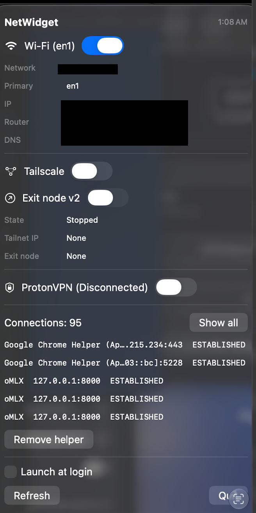
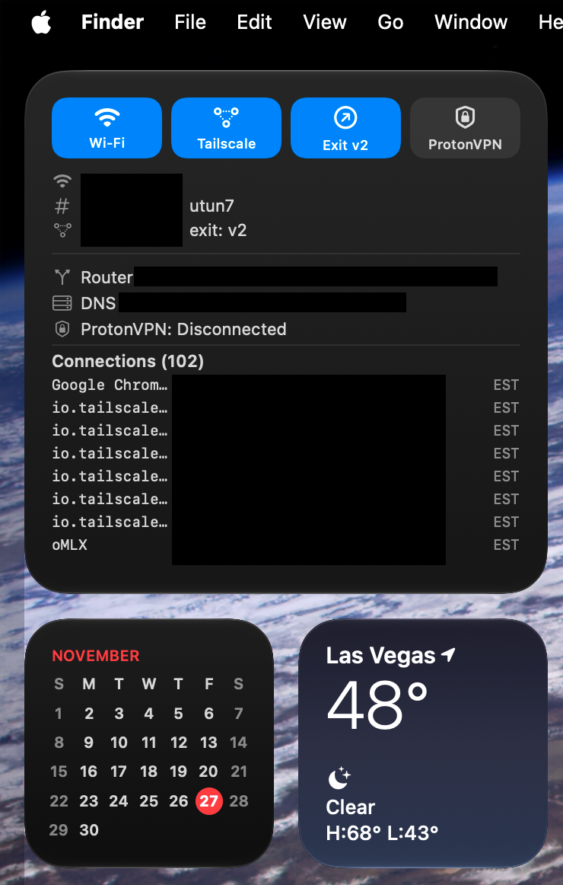

# NetWidget

NetWidget is a macOS menu bar app and widget that shows your network at a glance: the Wi-Fi network you're on, your router and IP address, your DNS settings, Tailscale and VPN status, and every app holding a live connection and the ports it's using. I built it while troubleshooting connection problems with a UTM virtual machine running alongside a Tailscale exit node and a VPN, when I needed to see my DNS and IP at a glance.

  
  

## Features

**Menu bar app**
- Wi-Fi on/off toggle, with the network name, primary interface, IP address, router and DNS servers
- Tailscale on/off toggle, with its state and tailnet IP
- Exit node toggle, showing which exit node is in use
- ProtonVPN on/off toggle, with connection status
- Live connections: which app holds each connection, the address and port, and its state, with a Show all view
- Launch at login, Refresh, and Remove helper

**Desktop widget**
- One-tap toggles for Wi-Fi, Tailscale, the exit node and ProtonVPN
- Network, tunnel interface, router, DNS and VPN status at a glance
- A live list of active connections

## How it's built

NetWidget has three parts:

- **App**: the menu bar app.
- **Widget**: a WidgetKit extension for the desktop.
- **Helper**: a small privileged helper installed as a LaunchDaemon. The app and widget can't run privileged commands themselves, so the helper does that one job and nothing else.

Requires macOS 14 or later. The Xcode project is generated with XcodeGen from `project.yml`; the generated `.xcodeproj` isn't committed. Hardened runtime is on.

## Security model

The helper runs as root, but only for a fixed list of approved commands (see `App/AllowedCommands.swift`):

- Wi-Fi on/off (`networksetup`)
- Tailscale status, up, down, and exit node on/off
- VPN list, start and stop (`scutil`)

Each command has a fixed program path and fixed arguments. Nothing is built from text and no shell is used, so extra commands can't be slipped in. The only values that can change are the Wi-Fi interface name and the VPN ID, and both are checked against what the Mac reports at that moment. Anything else is refused.

The helper checks the code signature of whatever is calling it (`Shared/CodeSigning.swift`), so only NetWidget itself can use it. It also refuses to run without a Developer ID signature, so an ad-hoc build can't use the privileged part.

## Building

Needs Xcode and XcodeGen (`brew install xcodegen`).

- `./build.sh test`: generates the project and runs the unit tests, unsigned.
- `./build.sh dev`: an ad-hoc signed build into `build/dev/`, for checking the layout only. The privileged helper won't run in this build.
- `./build.sh release`: the Developer ID signed build. Copy `Config/Signing.local.xcconfig.example` to `Config/Signing.local.xcconfig` and add your Team ID first.
- `./notarize.sh <keychain-profile>`: notarizes the release build. It never sees your Apple ID password.

## Tests

`./build.sh test` runs the unit tests. They cover the command allowlist (`AllowedCommandsTests.swift`) and the output parsers (`ParserTests.swift`).

## License

MIT. See [LICENSE](LICENSE).
